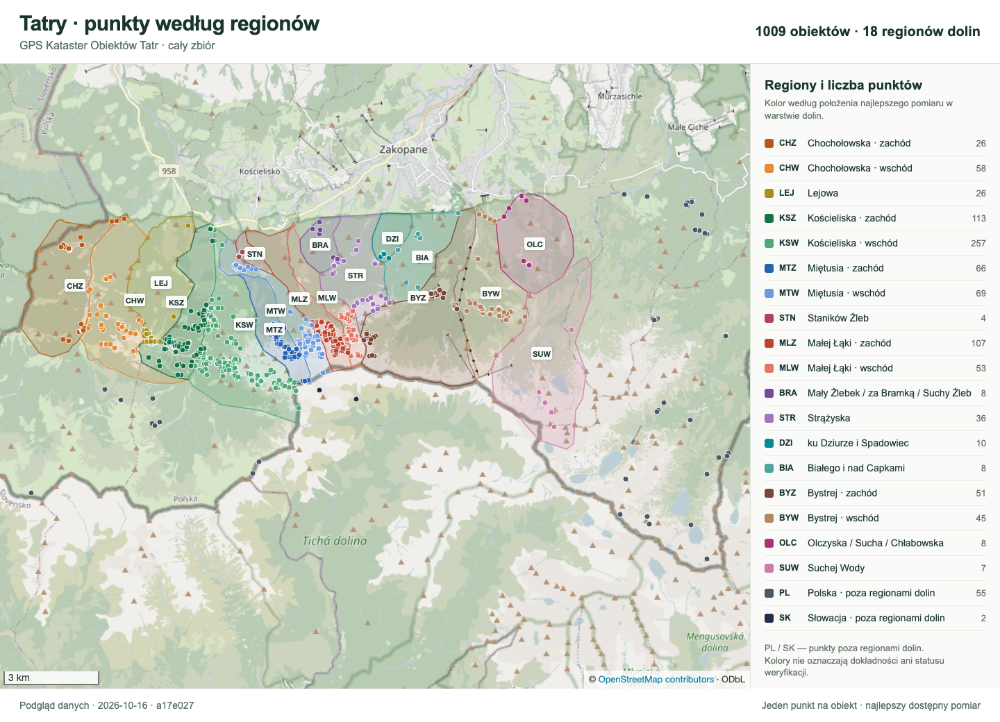
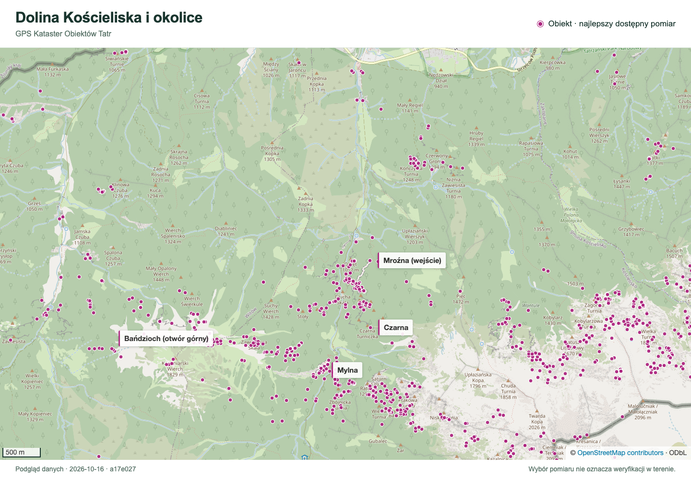

[🇵🇱 Polski](README.md) | 🇬🇧 **English** | [🇸🇰 Slovenčina](README.sk.md)

# GPS Registry of Tatra Cave Entrances and Karst Features

[](https://github.com/dlubom/gps-kataster-obiektow-tatr/releases/latest)

**[Download GPS points — GPX](https://github.com/dlubom/gps-kataster-obiektow-tatr/releases/latest/download/best-measurements.gpx)** · [All files and release notes](https://github.com/dlubom/gps-kataster-obiektow-tatr/releases/latest)

## What you will find here

Coordinates of cave entrances and adits in the Tatras, with their sources
and measurement history. Each entrance is a separate point, so one cave
may have several points. The collection is growing and is not a complete
inventory of either the Polish or Slovak Tatras.

Cavers can load the points onto a GPS receiver; cartographers can
use them in mapping software such as QGIS. Downloading the ready-to-use files
requires neither a GitHub account nor programming tools.

## Download the data

[Open the latest release](https://github.com/dlubom/gps-kataster-obiektow-tatr/releases/latest), expand **Assets** (downloadable files),
and choose a filename from this table.

| I want to… | File to download |
|---|---|
| Load points onto a GPS receiver | [GPX — `best-measurements.gpx`](https://github.com/dlubom/gps-kataster-obiektow-tatr/releases/latest/download/best-measurements.gpx) |
| Open a formatted Excel workbook | `katalog.xlsx` — **Best** and **Full** sheets |
| Download a CSV table | [CSV — `best-measurements.csv`](https://github.com/dlubom/gps-kataster-obiektow-tatr/releases/latest/download/best-measurements.csv) |
| Use a point layer in QGIS or other mapping software | `best-measurements.geojson` or `best-measurements.shp.zip` |
| Analyse the full measurement history | `katalog.sqlite.zip` — a database for advanced users |

The Excel workbook will be available in releases after v1.0.4. **Best** contains
selected points; **Full** contains detailed records and measurement history,
including older and rejected measurements. Filters and frozen headers are
included. Column names are in Polish.

### Smaller GPX files

The complete `best-measurements.gpx` contains the entire dataset. For apps
with an import limit, three additional files contain up to **500 points each**:

| File | Area |
|---|---|
| `chocholowska-lejowa-koscieliska.gpx` | The complete Chochołowska, Lejowa and Kościeliska valleys. |
| `mietusia-sucha-woda.gpx` | From Miętusia through Małej Łąki and the foothill valleys to Bystrej, Olczyska and Suchej Wody. |
| `pozostale-pl-sk.gpx` | Points in Poland and Slovakia outside our defined valley regions. |

Together these three files cover the entire dataset, with each point in exactly
one file. Both sides of each valley stay together. Assignment uses the selected
measurement's location. These files will be available in releases after v1.2.1.

## Accuracy and verification

Many locations come from catalogues and have not been confirmed in the field.
“Best available measurement” means a selection from the data we have, not a
guarantee of the exact entrance position. Missing accuracy means **unknown accuracy**.

In releases after v1.0.4, GPX labels show entrance and feature names;
the point ID stays in the description (and in the label if no name is available).
The GPX includes sources and notes, but has no separate verification
status or accuracy fields. To check them, open the [CSV table](https://github.com/dlubom/gps-kataster-obiektow-tatr/releases/latest/download/best-measurements.csv) in a
spreadsheet and find the point's code in the `object_id` column. In Excel,
use ‘ID obiektu’: verification and accuracy are in Best, full notes in Full.

| Column | How to read it |
|---|---|
| `verification_status` | `nieweryfikowany`: not yet confirmed by the project, not necessarily wrong. `zweryfikowany`: accepted after assessing sources or checking in the field. `odrzucony`: considered incorrect or unsuitable. |
| `horizontal_accuracy_m` | Declared horizontal accuracy in metres. A blank means no information. |
| `source`, `source_ref` | Where the measurement came from and its source reference, e.g. TPN or PIG. |
| `measurement_notes` | Notes on the measurement, discrepancies and location limitations. |

## How much of the data has been checked

Releases after v1.0.4 will include expandable **Release statistics (EN)**,
also in Polish and Slovak, on the [latest release page](https://github.com/dlubom/gps-kataster-obiektow-tatr/releases/latest). The tables
are generated automatically from the same data package. They count objects,
caves and measurements, object types, sources, verification statuses and
points with declared or unknown accuracy. Downloadable points and the full
measurement history are counted separately. In releases after v1.3.0, a position-method table distinguishes
GNSS, GNSS-anchored LiDAR and survey networks; “Project work” identifies
the source. GNSS does not automatically mean a geodetic survey.
Version v1.0.4 and earlier do not
include these tables.

## Points on the map



**[Open the full-size map to read the legend](docs/images/tatry-regiony-osm.png?raw=true)**

Colours show valley regions; legend counts refer to objects in the collection,
not numbers of caves or the completeness of a valley's inventory. PL and SK
mark points outside the defined valley regions. Colour does not indicate
accuracy or verification status. The map labels are in Polish.

<details>
<summary>View a closer map: Kościeliska Valley and surroundings</summary>



[Open the close-up at full size](docs/images/dolina-koscieliska-osm.png?raw=true).
Pink dots represent one selected measurement per object within the view.

</details>

Both maps are static previews dated **2026-10-16** and do not update with the
downloadable files. Basemap: © [OpenStreetMap contributors](https://www.openstreetmap.org/copyright)
(ODbL). [Image sources and preparation](docs/images/README.md).

## Three connected projects

Three repositories describe the same area from different perspectives:

| Project | The question it answers | What it provides |
|---|---|---|
| **GPS Registry of Tatra Cave Entrances and Karst Features** (this project) | Where is a specific cave entrance or other field feature? | The best available coordinates together with their source, history and verification status. |
| [Tatra Cave Registry](https://github.com/dlubom/Jaskiniowy-Kataster-Tatr-Zachodnich) | What routes do the survey centrelines follow, and what is the geometry of the underground system? | Walls and Survex survey data, 2D visualisations and an [online 3D model](https://dlubom.github.io/Jaskiniowy-Kataster-Tatr-Zachodnich/) for caves with available surveys; ready-to-use files are in the [latest release](https://github.com/dlubom/Jaskiniowy-Kataster-Tatr-Zachodnich/releases/latest). |
| [Georeferencer](https://github.com/dlubom/Georeferencer) | How does a scanned cave plan align with a map? | Georeferenced cave-plan scans in GeoTIFF format, including caves without survey data in the Tatra Cave Registry; the package is available from the [latest release](https://github.com/dlubom/Georeferencer/releases/latest). |

This registry is the shared source of entrance coordinates: both the Tatra
Cave Registry and Georeferencer use the best measurements published here.

## Contact and corrections

Have a better measurement, a missing entrance or an error to report? The easiest
way is to email Darek: **darek.lubomski [at] gmail [dot] com**.
Replace `[at]` with `@` and `[dot]` with `.`, and remove the spaces.

You can also [report a measurement or error on GitHub](https://github.com/dlubom/gps-kataster-obiektow-tatr/issues/new?title=Measurement+or+correction&body=Cave+and+entrance+%2F+point+code%3A%0ACoordinates%3A%0ADate+and+device+%2F+method%3A%0AAccuracy+%28if+known%29%3A%0ASource+and+correction+details%3A%0APhoto+or+notes%3A%0A). The form
includes prompts and requires a GitHub account. Reports are public.

Include the cave and specific entrance name (or point code), coordinates,
date, device or method, known accuracy and data source. A photograph of the
entrance or an approach description helps identify it. Mark unknown details
as unknown; you do not need to edit project files yourself.

## For developers and data maintainers

YAML files in `data/` are the source of truth. SQLite, GeoJSON, GPX, CSV, Excel and
Shapefile files are generated artifacts.

`Obiekt` represents a specific physical feature recorded as a point, while
`Jaskinia` is a catalogue record that groups one or more entrances. Every
object preserves its full measurement history and identifies the current best
measurement.

### Quick start

```bash
uv sync
uv run pytest
uv run python scripts/validate.py
uv run python scripts/build_release_artifacts.py
```

Local artifacts are written to `build/` and are not committed.

### Project documentation

- [Specification and domain model](specyfikacja_gps_kataster_obiektow_tatr_v_2.md)
- [Adding and verifying measurements](docs/operations.md)
- [Release file formats and fields](docs/release_artifacts.md)
- [CHANGELOG.md](CHANGELOG.md)

Public releases follow Semantic Versioning with `vX.Y.Z` tags and are
published manually. The repository, documentation and generated data exports
are licensed under Creative Commons Attribution 4.0 International, as stated
in [LICENSE](LICENSE).
