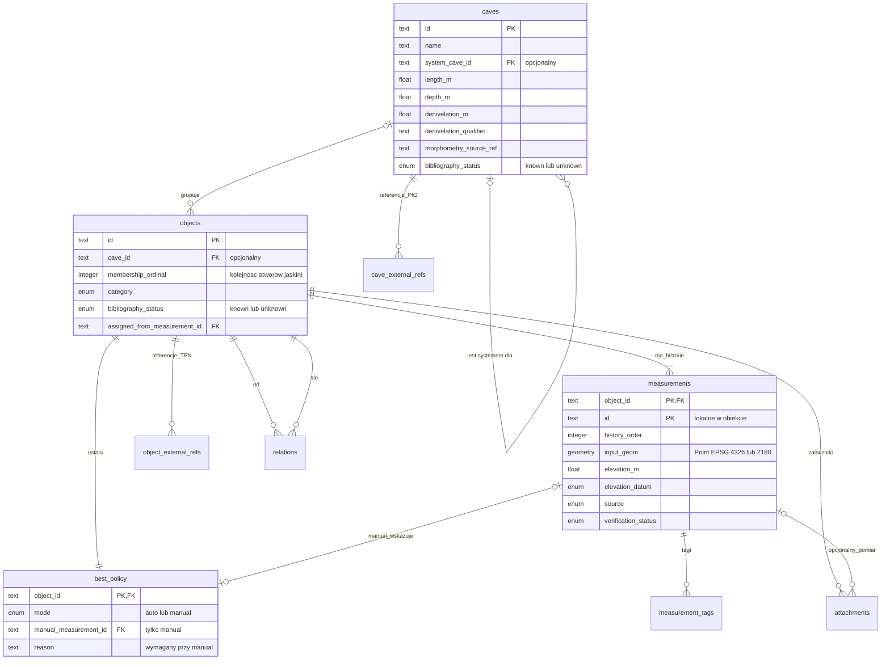
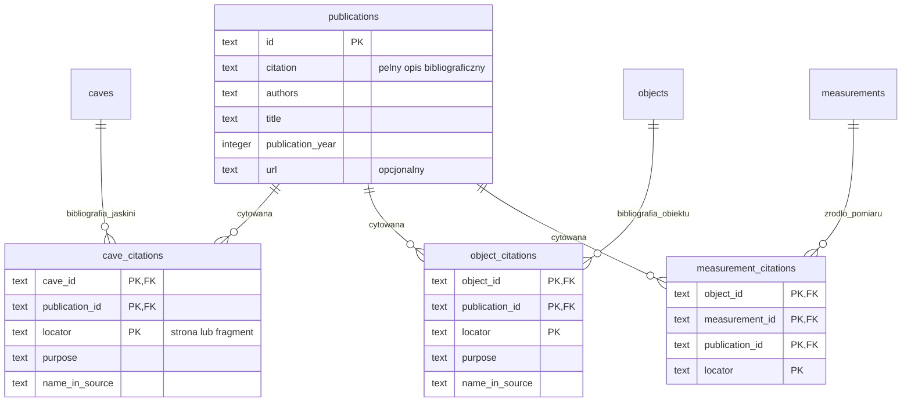
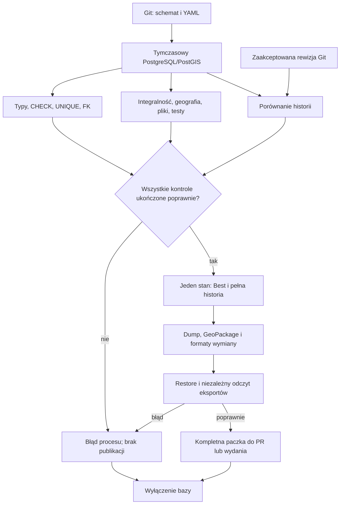

# Model bazy i przepływ publikacji

Źródłem definicji wykonywalnych jest [schema/catalog.sql](../../schema/catalog.sql).
Diagramy pokazują relacje i kluczowe pola; pola audytowe oraz opcjonalne
metadane opisuje DDL. Minimum jednego pomiaru i jednej polityki Best wymusza
łącznie schemat oraz zapytania integralności.

## Obiekt, jaskinia i historia

[Otwórz schemat jako PNG](diagrams/catalogue.png).

FK do pomiaru zawiera zawsze ID obiektu. Jedna jaskinia może nie mieć
rozpoznanych otworów; obiekt może nie być jeszcze przypisany do jaskini.
Lista obiektów jaskini jest wyliczana z FK, bez drugiego ręcznego zapisu.
Część może wskazywać jeden system przez `caves.system_cave_id`.
System wskazany przez część sam nie może wskazywać systemu.

## Publikacje i przywołania

[Otwórz schemat jako PNG](diagrams/bibliography.png).

Pełne cytowanie ma pozwolić znaleźć materiał bez działającego odnośnika.
`unknown` jest dopuszczalne także dla nowego obiektu lub jaskini.
`known` wymaga odpowiedniego cytowania. Referencja TPN i literatura to różne
informacje; literatura jaskini nie przechodzi automatycznie na jej otwory.

## Baza jako etap CI/CD

[Otwórz schemat jako PNG](diagrams/pipeline.png).

Niepewność jawnie dopuszczona przez model daje ostrzeżenie. Błąd, timeout
lub brak wymaganej kontroli nie może zostać uznany za wynik poprawny.
Przejście PR nie publikuje wydania; wydanie nadal wymaga osobnego polecenia.

## Utrzymanie diagramów

Bloki Mermaid powyżej są edytowalnym źródłem diagramów; pliki PNG są
wersjami do odczytu także poza przeglądarką Markdown. Po zmianie modelu
zaktualizuj odpowiedni blok i wyrenderuj go ponownie przez Mermaid CLI
(`@mermaid-js/mermaid-cli@12.0.0`, `--size 2000 -b white -t neutral`).
