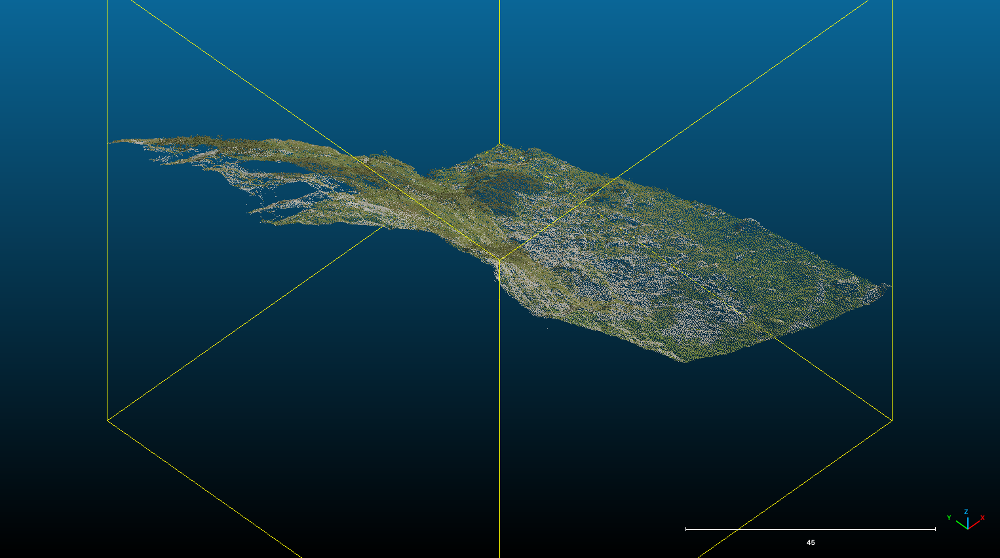

# PBI-112 — LiDAR do oceny otworów: dostępność i próba techniczna

Data: 2026-10-23. Baza: `caf7bae69b28eb037810215889cb87f763b2c6bd`.
Zakres zlecony: research danych i narzędzi dla Pod Wantą i Śnieżnej,
z rozpoznaniem możliwości przyszłego skilla. Status: research i próba
pobrania/przycięcia zakończone; identyfikacja progu i jego wysokości nierozstrzygnięta.
Nie wdrożono skilla ani nie zmieniono katalogu, kodu, best lub statusów pomiarów.

## Wniosek

Można od razu pracować na publicznych chmurach GUGiK z 2025 r., a następnie
porównać je z 2023 r. Dostępne QGIS i CloudCompare wystarczają do pilotażu.
Pobrano dwa arkusze, wykonano i odczytano małe wycinki, wczytano oba w
CloudCompare. To potwierdza wykonalność przygotowania materiału, ale nie
widoczność ani poprawną lokalizację samych otworów.

Obecny NMT TPN już pochodzi z ALS: 14–15.10.2019, 12 pkt/m², raster 0,5 m
z klasyfikowanych punktów przez TIN/TerraSolid. Chmura zachowuje geometrię
3D utraconą w rastrze; zmiana formatu sama nie poprawia georeferencji.
Dokładność bezwzględna, gęstość punktów i wielkość komórki to różne parametry.
[TPN, opis topografii, s. 4](https://geoportaltatry.pl/informacje_o_usludze/topografia.pdf).

## Konkretne obiekty

Punkty z YAML na bazowym SHA; kolejność w tabeli to lat, lon WGS84.

| Obiekt | Punkt TPN m-002, obecny best | Starszy punkt PIG m-001 |
|---|---|---|
| Pod Wantą, MTW-0054 / C-0711 / T.E-12.03 | 49.24158679002186, 19.91141386272168 | 49.24063334, 19.91146104 |
| Śnieżna, MLZ-0068 / C-0648 / T.E-13.01 | 49.24018529855171, 19.926428687029865 | 49.24014727, 19.92646948 |

Pod Wantą: rozbieżność PIG–TPN wynosi **106,0247 m** z zapisanych współrzędnych
PL-1992. Dlatego wycinek obejmuje obie pozycje. Nie wybrano zwycięskiego punktu.
To Jaskinia pod Wantą (Litworowy Dzwon), nie Dziura pod Wantą.
Śnieżna oznacza konkretny otwór T.E-13.01, nie cały system Wielkiej Śnieżnej
ani Śnieżną Studnię.

PIG opisuje Pod Wantą jako otwór ok. 1,2 × 5 m, SSW, z zaklinowaną płytą;
Śnieżną jako otwór ok. 2 × 2 m, E, za głazem u podnóża ściany, często ze śniegiem.
To trudne testy widoczności z góry. Do przyszłej próby warto dodać znany,
otwarty od góry lej jako kontrolę dodatnią.
[PIG: Pod Wantą](https://jaskiniepolski.pgi.gov.pl/Details/Information/1535),
[PIG: Śnieżna](https://jaskiniepolski.pgi.gov.pl/Details/Information/496).

## Dostępne dane

Zapytano wszystkie roczniki ujawnione przez WFS GetCapabilities:
KRON86 2010–2019 i EVRF2007 2018–2026. BBOX EPSG:4326 w kolejności osi WFS:
`49.239,19.910,49.243,19.929`. W tym prostokącie znaleziono 2012, 2023 i 2025.
Nie jest to dowód braku innych nalotów dla całych Tatr.

| Data `akt_data` w skorowidzu | Gęstość nominalna | `blad_sr_wys` | `blad_sr_syt` | Układ wysokości |
|---|---:|---:|---:|---|
| 2012-08-19 | 4 pkt/m² | 0,15 m | 0,50 m | PL-KRON86-NH |
| 2023-09-06 | 12 pkt/m² | 0,10 m | 0,25 m | PL-EVRF2007-NH |
| 2025-08-13 | 12 pkt/m² | 0,05 m | 0,06 m | PL-EVRF2007-NH |

To **deklaracje skorowidza**, nie lokalny pomiar błędu progu jaskini.
`akt_data` jest datą aktualności źródła; nie zastępuje analizy czasu punktów.
Wszystkie rekordy podają PL-1992 i „Skaning laserowy”. 12 pkt/m² odpowiada
orientacyjnemu odstępowi 0,289 m przy regularnym rozkładzie, a nie siatce 5 cm.
Gęstość na pionowej ścianie może być znacznie niższa niż na rzucie XY.

Źródła tabeli: [WFS EVRF2007](https://mapy.geoportal.gov.pl/wss/service/PZGIK/DanePomiaroweLidarEVRF2007/WFS/Skorowidze)
i [WFS KRON86](https://mapy.geoportal.gov.pl/wss/service/PZGIK/DanePomiaroweLidarKRON86/WFS/Skorowidze).
Surowe odpowiedzi, możliwości usług i [odczyt 16 rekordów](PBI-112/lidar-tatry-index.json)
zachowano obok raportu; [sumy kontrolne](PBI-112/SHA256SUMS).

| Obszar | Plik 2025 pobrany i odczytany | Pozostałe potwierdzone adresy ze skorowidza |
|---|---|---|
| Pod Wantą | [78 110 868 B, arkusz …1-2-1-3](https://opendata.geoportal.gov.pl/NumDaneWys/DanePomiaroweLAZ/83768/83768_1784517_M-34-100-B-d-1-2-1-3.laz) | [2023](https://opendata.geoportal.gov.pl/NumDaneWys/DanePomiaroweLAZ/78164/78164_1414495_M-34-100-B-d-1-2-1-3.laz), [2012](https://opendata.geoportal.gov.pl/NumDaneWys/DanePomiaroweLAZ/4979/4979_281537_M-34-100-B-d-1-2-1.laz) |
| Śnieżna | [84 241 618 B, arkusz …1-2-2-3](https://opendata.geoportal.gov.pl/NumDaneWys/DanePomiaroweLAZ/83768/83768_1784521_M-34-100-B-d-1-2-2-3.laz) | [2023](https://opendata.geoportal.gov.pl/NumDaneWys/DanePomiaroweLAZ/78164/78164_1414499_M-34-100-B-d-1-2-2-3.laz), [2012](https://opendata.geoportal.gov.pl/NumDaneWys/DanePomiaroweLAZ/4979/4979_281538_M-34-100-B-d-1-2-2.laz) |

GUGiK udostępnia LAZ bezpłatnie. Są to dane pomiarowe po georeferencji
i klasyfikacji, nie nieprzetworzony zapis instrumentu. WFS/WMS skorowidzów
zwraca adres arkusza, nie przestrzenny wycinek punktów. W Geoportalu jest
także podgląd chmury i przekrojów. [Oficjalna instrukcja](https://www.geoportal.gov.pl/pl/dane/dane-pomiarowe-lidar-lidar/)
odczytana również w Chrome.

Nie znaleziono publicznego URL do oryginalnej chmury TPN 2019 ani potwierdzenia
jej dokładności i formalnego datum Z. Pozostaje możliwość zapytania TPN o LAS/LAZ,
raport jakości, trajektorie, podział pasów i ortofoto/zdjęcia ukośne. Nie wysłano zapytania.

## Próba na rzeczywistych plikach

Pliki robocze: `build/research/lidar-2026-10-23/` (ignorowane przez git).
Pobrano całe dwa LAZ 2025 i przycięto bez filtrowania klas, interpolacji,
reprojekcji i przerzedzania. Pod Wantą: 104,71 × 205,92 m; Śnieżna: 100 × 100 m.

| Wynik | Punkty | Bajty LAS | `PointSourceId` | Punkty klasy 2 / klasy 12 |
|---|---:|---:|---|---:|
| `pod-wanta-2025-both-positions.las` | 582 112 | 19 792 239 | 79, 80, 81, 82 | 412 996 / 16 301 |
| `sniezna-2025-100m.las` | 264 297 | 8 986 529 | 80, 81, 82 | 232 775 / 8 070 |

Źródłowe arkusze mają odpowiednio 8 378 466 i 8 751 453 punktów.
Oba: LAS 1.2, format punktu 3, skala zapisu 0,01 m. To kwantyzacja zapisu,
nie centymetrowa dokładność. Dostępne RGB, intensywność, klasy, odbicia,
GPS Time, ScanAngleRank, PointSourceId. Szczegółowe liczniki i hashe:
[inspection.json](PBI-112/inspection.json). Sprawdzono nagłówki i wszystkie
rekordy obu nieskompresowanych wycinków, sumy liczników, granice i rozmiary.

W nagłówkach odczytanych przez PDAL **brak pionowego CRS**; EPSG:2180 jest
obecny. PL-EVRF2007-NH wynika z powiązanego skorowidza, który trzeba zachować
razem z plikiem. Nie dopisano datum do nagłówka ani nie wykonano transformacji Z.

Wycinki zawierają kilka grup źródłowych i klasę 12 (overlap w tej starszej
konwencji LAS). Nie oznacza to jeszcze odmiennych kierunków obserwacji progu.
`ScanDirectionFlag` opisuje kierunek ruchu skanera, nie azymut samolotu.
Znaczenie ID pasa wymaga metadanych konkretnego zamówienia.
[Specyfikacja LAS](https://asprslas.org/stable/02.00_definition.html).

Lokalnie: QGIS w `/Applications/QGIS-final-4_0_1.app`, działający
`pdal_wrench 1.4.0 / PDAL 2.9.3 / GDAL 3.12.0`; GUI CloudCompare
`v2.14.beta (Aug 27 2026)` (bundle deklaruje 2.14.0).
Oba LAS wczytały się w CloudCompare. Dla Śnieżnej obejrzano widok z góry
i izometryczny; widoczna jest geometria zbocza i skał. Nie wskazano progu.
Zachowano Global Shift `(-567000,-152000,0)`, skalę 1.
To przesunięcie obliczeniowe, nie zmiana CRS.



Próba interfejsu potwierdza użyteczność małych plików, nie kończy oceny
otworu. Nie wykonano porównania 2023–2025, orientowanych przekrojów progu,
kontroli terenowej ani niezależnej oceny błędu lokalnego.

## Odtworzenie

Pobrać powyższe pliki 2025 do wskazanego katalogu jako
`pod-wanta-2025-source.laz` i `sniezna-2025-source.laz`.
Sprawdzić rozmiary i SHA-256 z `inspection.json` przed przetwarzaniem.
WFS: `service=WFS`, `version=2.0.0`, `request=GetFeature`,
`typenames=gugik:SkorowidzDanychPomiarowychLIDAR2025`, `srsname=EPSG:4326`,
`bbox=49.239,19.910,49.243,19.929,urn:ogc:def:crs:EPSG::4326`.
Dla innych lat dobrać type name z zapisanych GetCapabilities.

Poniższe polecenia wykonano w katalogu głównym repo (wyjścia muszą być nowe).
W LAS/PDAL X to easting, Y to northing; repo nazywa je odpowiednio
`y_1992` i `x_1992`. Nie kopiować kolejności polskich osi bez przeliczenia.

```bash
export PROJ_DATA=/Applications/QGIS-final-4_0_1.app/Contents/Resources/qgis/proj
lidar_wrench=/Applications/QGIS-final-4_0_1.app/Contents/MacOS/pdal_wrench
lidar_dir=build/research/lidar-2026-10-23
"$lidar_wrench" translate --input="$lidar_dir/sniezna-2025-source.laz" \
  --output="$lidar_dir/sniezna-2025-100m.las" \
  '--bounds=([567364.24,567464.24],[152882.54,152982.54])'
"$lidar_wrench" translate --input="$lidar_dir/pod-wanta-2025-source.laz" \
  --output="$lidar_dir/pod-wanta-2025-both-positions.las" \
  '--bounds=([566269.78,566374.49],[152919.10,153125.02])'
"$lidar_wrench" info --input="$lidar_dir/sniezna-2025-100m.las"
"$lidar_wrench" info --input="$lidar_dir/pod-wanta-2025-both-positions.las"
```

Bez `PROJ_DATA` lokalny build zgłaszał brak proj.db. `--filter-bounds` nie jest
poprawną opcją; działa `--bounds`. W tym narzędziu błędne argumenty mogą
zakończyć się kodem 0, dlatego odbiór oparto na plikach, licznikach i odczycie,
nie samym exit code. [PDAL wrench](https://github.com/PDAL/wrench).

## Metoda i granice przyszłego skilla — rekomendacja

QGIS nadaje się do kontekstu mapowego i profili, CloudCompare do oglądu
ściany i obracanych przekrojów, PDAL do powtarzalnego przygotowania danych.
[QGIS profile](https://docs.qgis.org/3.44/en/docs/user_manual/map_views/elevation_profile.html),
[CloudCompare przekroje](https://www.cloudcompare.org/doc/wiki/index.php/Cross_Section),
[Global Shift](https://www.cloudcompare.org/doc/wiki/index.php/Global_Shift_and_Scale).

Zwykły LAZ pobieramy arkuszem, potem przycinamy. COPC/EPT może pozwolić
czytać zdalny mały obszar, jeśli istnieje taki produkt i serwer obsługuje
odpowiedni dostęp. Zbadane LAZ 1.2 nie są COPC. Lokalna konwersja do COPC
nie oszczędza pierwszego pobrania. [COPC](https://copc.io/),
[PDAL readers.copc](https://pdal.io/en/stable/stages/readers.copc.html).

Zalecany przepływ po tym rozpoznaniu:

1. Związać analizę z ID konkretnego otworu, wszystkimi kandydatami XY,
   zdjęciem i jednoznaczną definicją mierzonego progu.
2. Zachować źródło, datę, SHA, układy, parametry, pełne atrybuty i granice wycinka.
3. Oglądać osobno każdą epokę i grupę źródłową, pełną chmurę i grunt.
   Punkty noise/withheld oznaczać, nie uznawać za poprawne odbicia.
4. Zrobić widok od strony ekspozycji otworu, dwa przekroje i mapę pokrycia;
   wskazać rzeczywiste punkty podpierające interpretację progu.
5. Wynik opisowy: „obserwacja wspiera”, „niejednoznaczne”, „nieobserwowalne”
   lub „brak wystarczających danych”, z dowodami i niepewnością.
   Wysokości porównywać dopiero po uzgodnieniu datum; decyzję katalogową
   pozostawić operatorowi.

Brak odbić nie dowodzi braku otworu. Interpolacja może wypełnić rzeczywistą
pustkę, a ground classification usunąć istotne powierzchnie. Kilka przelotów
pomaga, jeżeli faktycznie zapewnia inne linie widzenia. Badania pokazują
możliwość detekcji otworów, lecz weryfikują kandydatów terenowo.
[Moyes i Montgomery 2019](https://doi.org/10.3390/geosciences9020098).

Jeśli brak widoczności z ALS, dalsze dane to TLS z kilku stanowisk lub
ukośna fotogrametria/UAV LiDAR z kontrolą geodezyjną. Przykład integracji
ALS/TLS dla pionowych i przewieszonych skał: [NPS Yosemite](https://www.nps.gov/yose/learn/nature/lidar-based-rock-fall-hazard-characterization-of-cliffs.htm).
Ortofoto i zdjęcia ukośne pomagają rozpoznać otwór; nie dają automatycznie
wysokości ukrytego progu. Sentinel-2 (najlepsze pasma 10 m) jest za mało
szczegółowy dla tych otworów. Nie oznacza to, że wszystkie zdjęcia satelitarne
mają 10 m. [ESA](https://www.esa.int/Applications/Observing_the_Earth/Copernicus/Sentinel-2/Facts_and_figures).

## Gotowe skille

W ograniczonym przeglądzie nie znaleziono gotowego skilla do walidacji
tatrzańskich otworów z ALS. Najbliższy ogólny przykład to
[OpenMapStack: geospatial-data-discovery](https://github.com/jaakla/openmapstack-skills/blob/main/skills/geospatial-data-discovery/SKILL.md):
wyszukiwanie danych GIS, proweniencja i układy odniesienia.
Nie zastępuje domenowej oceny otworu. Skill
[NVIDIA interpreting-lidar-pointclouds](https://github.com/NVIDIA-Omniverse/ovrtx/blob/main/skills/interpreting-lidar-pointclouds/SKILL.md)
dotyczy ekosystemu ovrtx, nie tego przepływu ALS. Niczego nie instalowano.
Rekomendacja: po szczegółowej ocenie wycinków stworzyć mały lokalny skill
przygotowujący i dokumentujący dowody. Powyższy zakres jest propozycją,
nie zatwierdzonym projektem implementacji.

## Odbiór i dalszy krok

- Live WFS, pobranie dwóch LAZ, przycięcie, odczyt nagłówków i wszystkich
  punktów wycinków, kontrola granic/liczników/rozmiarów i GUI: wykonane.
- Katalog i kod pozostają identyczne z bazą. Zmiana dotyczy wyłącznie dokumentacji
  i dowodów researchu; nie wymaga lokalnego buildu eksportów ani mutacji.
- Testy dokumentacji: `.venv/bin/python -m pytest tests/test_release_docs.py
  tests/test_operational_docs.py -q` — 5 passed. Kontrola lokalnych odnośników,
  XML, sum SHA-256 i zgodności liczników — poprawna.
- `git diff --cached --check` dla plików autorskich — poprawny. Dwa surowe
  XML GetFeature zachowano bajt w bajt, łącznie z mieszanymi wcięciami
  i pustą linią końcową otrzymanymi z usługi; pełny check zgłasza te odstępy.
- Niezależny przegląd nie znalazł błędów w raporcie, metadanych i wszystkich
  846 409 rekordach wycinków. Obejmował sumy, rozmiary i nagłówki źródłowych
  LAZ; nie powtarzał pobrania, obsługi GUI ani zewnętrznej kwerendy.
- Końcowy commit, zdalny SHA i CI dokładnego commitu wskazuje opis PR.
- Następny krok merytoryczny: osobna ocena progu w 2025 i porównanie 2023,
  ze zdjęciem otworu i kontrolą dodatnią. Nie oznaczać tych obiektów jako
  zweryfikowane na podstawie samego ukończenia tego researchu.
