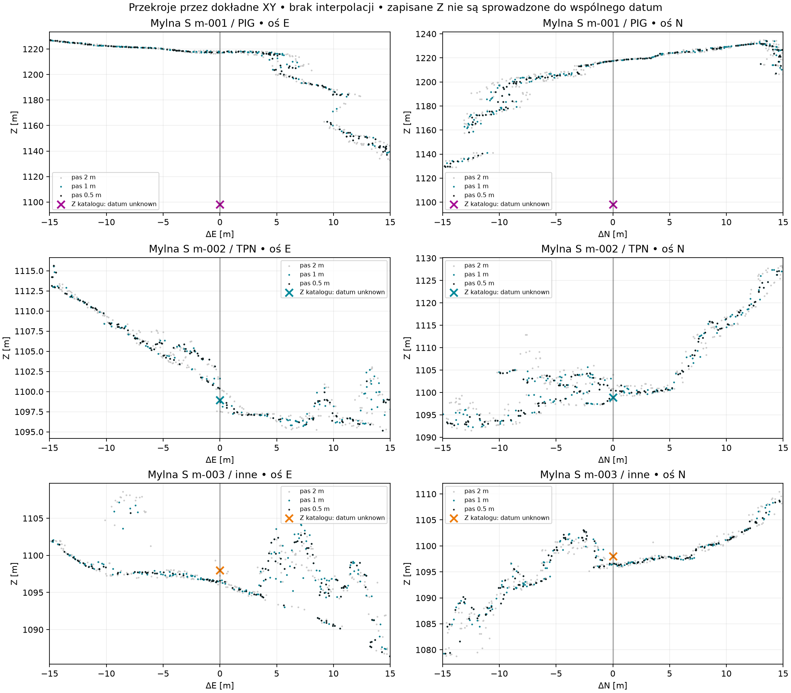
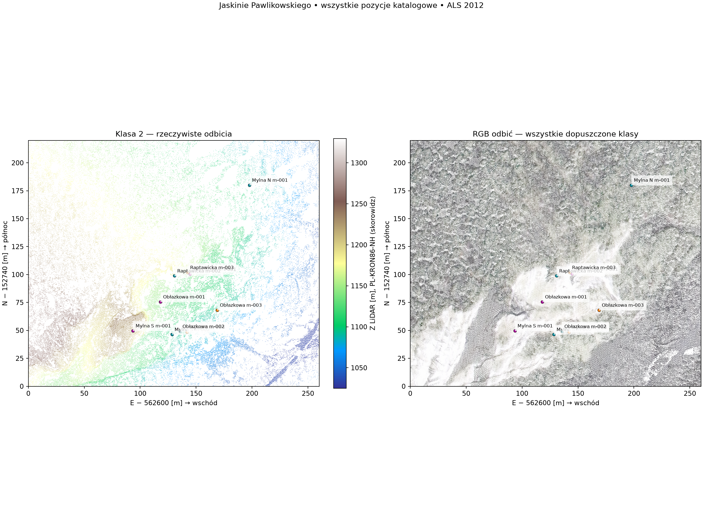
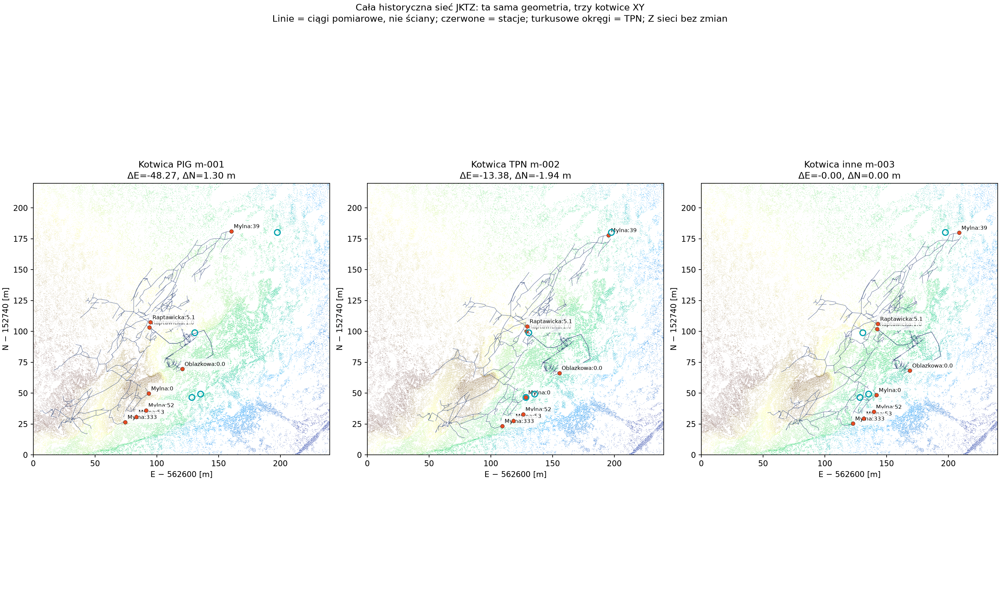
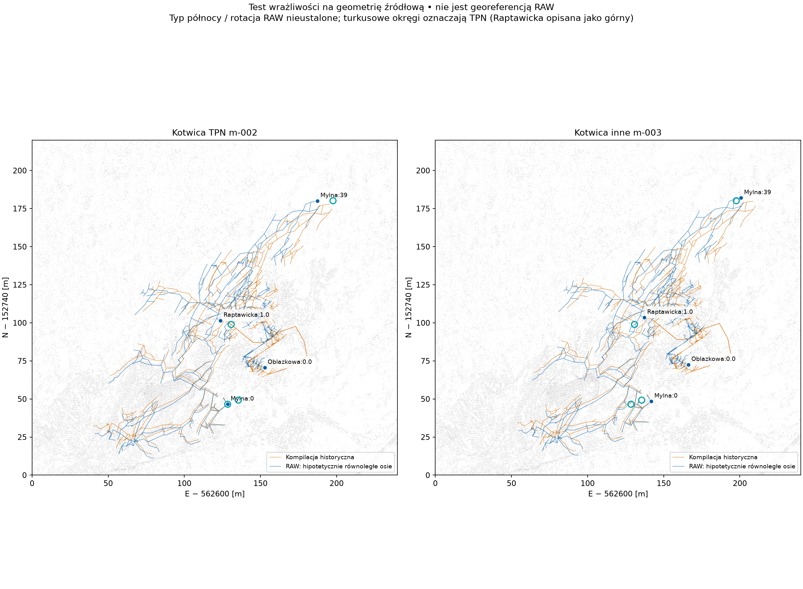

# PBI-116 — Mylna i cały system Pawlikowskiego w LiDAR

Badanie z 2026-10-24 dla [issue #36](https://github.com/dlubom/gps-kataster-obiektow-tatr/issues/36).
Baza GPS: `2a40b8e224ce248296e1d82742728bd9b8b6d8d1`.
Wykorzystano metodę testowego [PR #29](https://github.com/dlubom/gps-kataster-obiektow-tatr/pull/29)
z `05759aaf5eed6138a79fdd7e0d4270e29bafb42c`: pełne odbicia,
oddzielna kontrola klasy gruntu, przekroje, źródłowe indeksy i niezależny odczyt.
Nowe badanie powstało na gałęzi od aktualnego main; nie scala PR #29.

## Decyzja badawcza

**TPN m-002 jest najlepiej uzasadnionym kandydatem do dalszego potwierdzenia
głównego wejścia Mylnej. Nie potwierdzono jednak portalu ani progu na tyle,
aby rozstrzygnąć Best lub utworzyć nowy pomiar.** PIG m-001 jest silnie
niespójny z lokalizacją wejścia przedstawioną w źródłach. Historycznego
m-003 nie można odrzucić wyłącznie na podstawie obecnego materiału.

Wynik dotyczy rankingu hipotez, nie dokładności geodezyjnej. Zachowano
wszystkie YAML, pomiary, wysokości, statusy i ręczne wybory Best. Issue #36
pozostaje otwarte. Nie zmieniono JKTZ, Georeferencera ani ich publikacji.

| Wariant Mylnej S | Co rzeczywiście stwierdzono | Ocena |
|---|---|---|
| m-001 PIG | Nad tym XY odbicia gruntu w promieniu 1 m mają Z 1216,28–1218,49 m; pozycja jest 48,29 m od m-003. Cała sieć przesunięta do tego punktu słabo zgadza się z pozostałymi otworami. | Najsłabszy wariant wejścia; powierzchnia nad punktem nie wyklucza podziemnej jaskini. |
| m-002 TPN | Punkt przy przejściu bardziej stromego zbocza w półkę; grunt w promieniu 1 m 1097,48–1100,31 m. Przesunięta historyczna sieć zbliża północny otwór do jego TPN. | Najlepsza hipoteza do kontroli; nie zidentyfikowano obwodu wejścia. |
| m-003 historyczny JKTZ | Punkt na łagodniejszym fragmencie powierzchni; grunt w promieniu 1 m 1095,73–1096,63 m. Pierwotna metoda absolutnej kotwicy pozostaje nieudokumentowana. | Dotychczasowy Best pozostaje roboczo; inne źródłowe ułożenie sieci osłabia argument za prostym przesunięciem. |

Z w tej tabeli to odbicia ALS w **PL-KRON86-NH**, nie pomiary progów.
Z katalogu ma nieznane datum. Nie przeliczano różnic Z na korekty wysokości.
Najbliższe odbicie m-002 jest klasą 4, a m-003 klasą 3; samo najbliższe Z
nie jest gruntem. Wyższe odbicia przy m-002 są w dużej części klasami
roślinności: nie nazwano ich stropem ani okapem.

## Dostępna chmura i jej ograniczenia

Dla lokalnego BBOX skorowidz GUGiK EVRF 2018–2026 nie zwrócił arkuszy;
kontrolne, szersze zapytanie zwróciło 48 arkuszy 2023/2025 po wschodniej
stronie. To wynik publicznego skorowidza, nie dowód braku wszelkich innych
nalotów. **Nalotu 2025 z PR #29 nie można zastosować do Mylnej.**

Pobrano dwa arkusze z aktualnością **2012-08-19**. Skorowidz deklaruje
PL-1992 / PL-KRON86-NH, 4 pkt/m² oraz błędy XY 0,50 m i Z 0,15 m.
To parametry produktu, nie dokładność rozpoznania otworu. Nagłówki LAZ
mają pusty WKT; oba układy pochodzą ze związanych metadanych WFS.
Źródła, zapytania, metadane i SHA: [acquisition.json](PBI-116/acquisition.json).

Wycinek E 562545–562871, N 152694–152982 m obejmuje całą sieć, wszystkie
trzy translacje kotwicy i otoczenie. Zachowano **965 828 rekordów**, w tym
137 686 klasy 2. Do oglądu dopuszczono 965 825, wyłączając noise/withheld;
źródłowy LAS pozostał pełny. Nie interpolowano, nie triangulowano,
nie wygładzano ani nie przerzedzano danych. Większość odbić stanowi
roślinność. Rok 2012 poprzedza plan systemu z 2015 r.; nie porównano epok.

Rzuty boczne w [widoku Mylnej](PBI-116/mylna-s-views.png),
[Obłazkowej](PBI-116/oblazkowa-views.png),
[Raptawickiej](PBI-116/raptawicka-views.png) i
[północnego wyjścia](PBI-116/mylna-n-views.png) sumują punkty całego okna.
Nie są przekrojami cienkiej ściany ani zdjęciami portalu. Skale kolorów
wszystkich klas i klasy 2 w każdym zbliżeniu są wspólne. Odrębne przekroje
przez każdą pozycję mają długość 30 m i pełne szerokości 0,5/1/2 m:
[Obłazkowa](PBI-116/KSZ-0090-sections.png),
[Raptawicka](PBI-116/KSZ-0047-sections.png),
[Mylna N](PBI-116/KSZ-0113-sections.png).

## Cały system zmienia interpretację

Odtworzono historyczną sieć JKTZ z `773c8e2`: **705 stacji**, 751 pomiarów,
749 rysowanych odcinków (dwa dowiązania zerowe), jedna kotwica Mylna:0.
Trzy scenariusze przesuwają wszystkie jej punkty w XY, zachowując geometrię
i Z. Linie oznaczają ciągi pomiarowe, nie ściany jaskiń.

Przeniesienie m-003 do m-002 oznacza **13,38 m na zachód i 1,94 m na południe**.
Stacja północnego wyjścia Mylna:39 zbliża się wtedy do TPN z 11,13 do 3,17 m.
Stacja głównej Raptawickiej 1.0 zbliża się z 11,94 do 2,15 m — ale ten drugi
wynik **nie jest poprawną kontrolą tożsamości otworu**: bieżący TPN opisuje
swój punkt jako `górny`. Na mapie pokazano także stację górną Raptawicka:5.1.
Żaden z tych dystansów nie jest błędem względem prawdy terenowej.

Oryginalny materiał Filara `_RAW` ma inne lokalne fixy i geometrię niż
historyczna kompilacja. Na przykład odległość Mylna:0–39 wynosi 145,965 m
w RAW, a 147,513 m po kompilacji. Działało ponowne wyrównanie, nie tylko
obrót. RAW nie dokumentuje typu północy ani deklinacji. Przy **wyłącznie
diagnostycznym** założeniu osi równoległych do PL-1992 ranking północnego
otworu odwraca się: 3,64 m przy m-003, 10,25 m przy m-002. Nie jest to
poprawna georeferencja RAW; pokazuje zależność pozornej przewagi od
przyjętej geometrii.

Nie dopasowano dowolnej rotacji/skali do TPN, bo bez rozpoznania wspólnych
punktów takie dopasowanie mogłoby jedynie ukryć konflikt.
[Historia, źródła i wpływ na projekty](PBI-116/network-sources.md),
[pełna sieć historyczna i RAW](PBI-116/network-raw-comparison.json).

## Tożsamość otworów i konflikty źródeł

- „Południowe” główne wejście Mylnej ma ekspozycję **ENE**. Okna
  Pawlikowskiego są osobnymi otwarciami podciętymi urwiskiem. Stacje
  52/53/333 pomagają zlokalizować okolicę okien; nie są obrysami otworów.
- Obłazkowa jest portalem SSE około 10 × 3 m, oddalonym od Mylnej według
  sieci o około 34 m. Jej TPN leży tylko 7,54 m od TPN Mylnej S i nie ma
  opisu miejsca pomiaru w portalu. Nie jest dobrym punktem kontrolnym bez
  wyjaśnienia identyfikacji.
- Raptawicka ma główną studnię około 3 m średnicy i 5 m głębokości oraz
  odrębny górny otwór. Dolne odbicia przy TPN są klasy 0; filtrowanie do
  samego gruntu usuwa istotną geometrię. Nie rozpoznano jednoznacznie
  którejś z tych form w chmurze.
- Plan Filara z 15.06.2015 podaje północną Mylną **1094 m**, tabela PIG
  **1084 m**; główną Raptawicką odpowiednio **1141 i 1146 m**. To konflikt
  materiałów źródłowych, nie podstawa do automatycznej korekty Z.

Oglądano oryginalny plan i przekrój całego systemu oraz fotografie
Obłazkowej i podejścia Raptawickiej. Nie wykonano metrycznego dopasowania
fotografii do chmury. [Opisy, grafiki i ich źródła](PBI-116/entrances.md).
Bieżący odczyt API TPN potwierdził wszystkie cztery XY do 5 mm względem
zapisu YAML; nie jest to deklaracja ich dokładności. [Odczyt TPN](PBI-116/tpn.md).

## Co jest potrzebne do rozstrzygnięcia Best

Najkrótszy dalszy krok to rozpoznać w terenie lub skanie naziemnym
**Mylna:0, północne wyjście 39 i oba otwory Raptawickiej**, określając
konkretny znak/środek progu. Obłazkowa stanowi dodatkową kontrolę portalu.
Co najmniej dwa pewne, odległe punkty pozwolą ocenić translację i orientację;
trzeci skontroluje zgodność całej sieci. Trzeba również ustalić orientację
i wersję źródłowej geometrii Filara. Brak odbić ALS nie dowodzi braku otworu.

Dzisiejszy JKTZ ma osobne fixy Mylnej, Obłazkowej i Raptawickiej pobierane
z GPS. Zmiana samej Mylnej może zmienić wyrównanie połączonej sieci, a nie
przesunąć całość sztywno. Georeferencer przeliczy odpowiednie plany dopiero
przy regeneracji. Ewentualną zmianę współrzędnych należy rozpatrzyć razem
z tymi zależnościami; nie wykonano jej w tym badaniu.

## Odtworzenie i odbiór

[Instrukcja techniczna](PBI-116/README.md) zawiera wejścia, wersje narzędzi,
polecenia i rozdział surowych źródeł od wyników. Duże LAZ/LAS i robocze
kompilacje są w ignorowanym `build/`; raport, obliczenia, skrypty, obrazy
i metadane są wersjonowane.

- Dwa niezależne dekodery (laspy i PDAL) porównały wszystkie **965 828**
  rekordów i 22 pola bez różnic.
- Odbiór przekrojów i najbliższych odbić wykonuje niezależny dekoder
  `struct`, bez importowania kodu analizy: **56 046 asercji, 5548 wierszy
  i kompletność 20 przekrojów — PASS**; wynik w
  [independent-readback.json](PBI-116/independent-readback.json).
- Niezależny przegląd interpretacji potwierdził ostrożny ranking hipotez;
  poprawiono kadr PIG, wspólną skalę kolorów, pokazanie górnej Raptawickiej
  oraz wybór rekordów dokładnie na granicy pasa.
- Testy dokumentacji, integralność JSON/XML, odnośniki, sumy i zachowanie
  `data/` sprawdzono przed dostarczeniem: 5 testów PASS; 13/13 produktów
  analizy identycznych bajtowo w dwóch uruchomieniach. Autorskie pliki
  przechodzą `git diff --check`; cztery surowe XML zachowują źródłowe
  mieszane wcięcia i pustą linię końcową zgłaszane przez pełny check.
  Końcowy SHA i CI są w opisie PR.

Status: badanie wykonane; wybór Best i identyfikacja progu pozostają otwarte.
