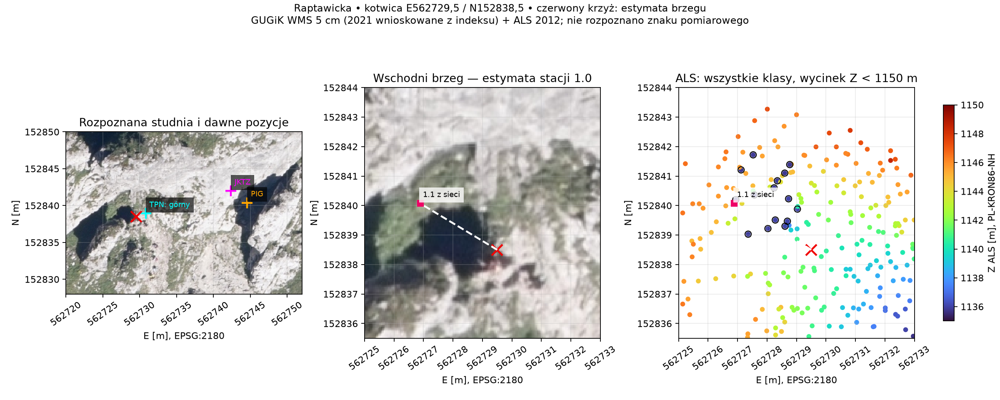
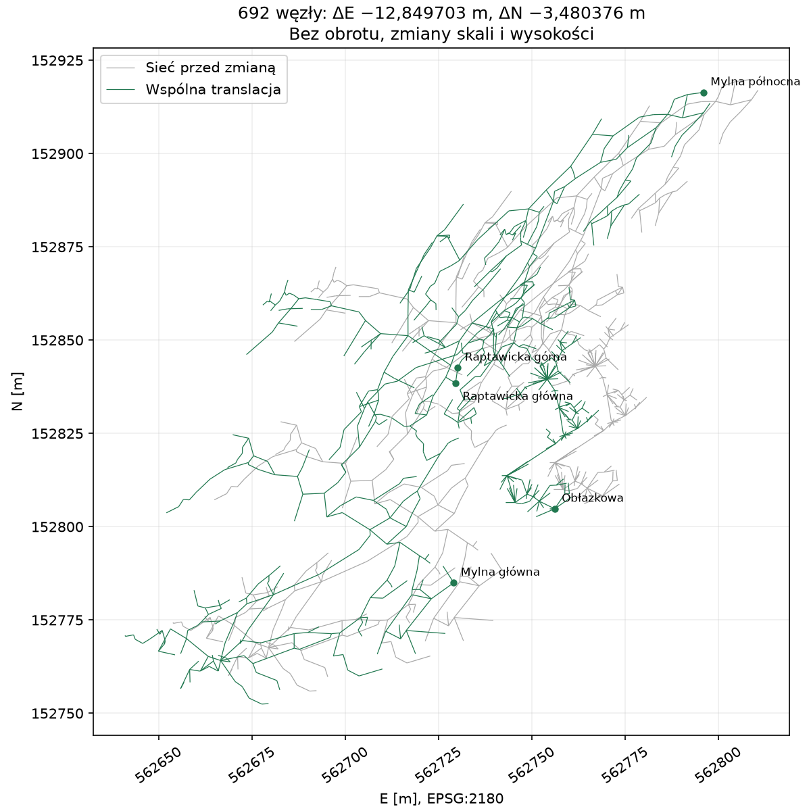

# PBI-117 — Raptawicka jako kotwica systemu Pawlikowskiego

Data opracowania: 2026-10-24. Zakres zlecony przez użytkownika: wybrać
możliwie dobrze uzasadnioną pozycję głównego otworu ze zdjęć i LiDAR,
a pozostałe punkty przenieść razem z istniejącą siecią, zachowując geometrię.
Kontekst: [issue #36](https://github.com/dlubom/gps-kataster-obiektow-tatr/issues/36),
badanie [PR #37](https://github.com/dlubom/gps-kataster-obiektow-tatr/pull/37)
oraz porównanie źródeł [JKTZ #143](https://github.com/dlubom/Jaskiniowy-Kataster-Tatr-Zachodnich/pull/143).

## Wybrany punkt i siła dowodu

**Raptawicka, główny otwór, estymata stacji `Raptawicka:1.0`:**
E **562729,5**, N **152838,5** w EPSG:2180;
WGS84 **49,2398375402° N, 19,8620426566° E**.
To środek interpretowanego obszaru wschodniego brzegu
E562729–562730 / N152838–152839. Nie rozpoznano fizycznego znaku stacji.
Jest to ustalenie zdalne; dokładność bezwzględna i datum wysokości pozostają
nieznane. Rozmiar piksela, obszar wyboru i liczba cyfr nie są dokładnością.

Na ortofotomapie widać niewielką, osobną studnię i dojście do jej wschodniego
brzegu. [Opis i plan PIG](https://jaskiniepolski.pgi.gov.pl/Details/Information/1387)
wskazują otwór około 3 m, studnię około 5 m z drabiną; plan Filara/Parczewskiego
2014 umieszcza poziom 0,00 przy wschodnim brzegu. Autorskie
[zdjęcia dojścia i drabiny](https://e-gory.com/tatry/jaskinia-raptawicka/)
wspierają rozpoznanie formy, lecz nie dostarczają współrzędnych stacji.
Przy dawnych pozycjach JKTZ i PIG nie rozpoznano takiej samej małej studni.

ALS zawiera 15 rzeczywistych, niewycofanych odbić klasy 0 w zakresie
E562726,94–562729,03 / N152839,03–152841,72 / Z1135,76–1136,09 m.
Obejmują dwa identyfikatory źródeł i trzy grupy czasu GPS. Odbicie przy brzegu
E562729,84 / N152838,27 ma Z1140,72 m, około 4,92 m nad niskimi odbiciami.
Układ jest zgodny z morfologią studni. Filtr wyłącznie klasy gruntu pomijałby
te istotne odbicia. Zbiór nie stanowi dowodu położenia konkretnego znaku.

Pierwszy odcinek sieci 1.0→1.1 schodzi w dół studni. Po translacji punkt 1.1
leży 0,139 m w poziomie od jednego z niskich odbić. To kontrola zgodności,
**nie dokładność 0,139 m**. Inne pobliskie kotwice też pasują do tego zbioru;
nie minimalizowano odległości do pojedynczego odbicia ani centroidu.
Wyboru brzegu dokonano ze zdjęcia i planu.



Punkt TPN leży około 1,38 m od estymaty, ale ma opis „górny”; nie posłużył
za kotwicę i nie zmieniono jego historii. Sieciowy otwór górny `5.1` leży
około 4,2 m na północ i 6 m wyżej. Jego znaku również nie rozpoznano.
Jedna kotwica ustala przesunięcie, nie weryfikuje orientacji ani skali sieci;
ich dotychczasowe wartości zachowano na polecenie użytkownika.

## Materiał źródłowy

- Orto GUGiK WMS HighResolution, zapis 5 cm/piksel. Datowanie 2021-09-09
  wynika z jedynego pokrywającego produktu wysokiej rozdzielczości w indeksie
  WFS; sama odpowiedź WMS nie zawiera daty. Próba pobrania fragmentu TIFF
  została przerwana, ponieważ serwer zignorował Range i zwrócił cały plik
  1,07 GB. Nie twierdzimy, że przeczytano ten TIFF.
- Natywny TIFF GUGiK 2024-08-14, 25 cm/piksel, sprawdzono niezależnie.
  Silniejszy cień ogranicza odczyt brzegu. Wycięcie bez resamplingu,
  URL, georeferencja oraz sumy: [imagery-sources.json](PBI-117/imagery-sources.json).
- Ogląd TPN ObliView/modelu 2020 służył rozpoznaniu kontekstu. Wyboru
  metrycznej kotwicy nie oparto na ekranowych współrzędnych zdjęć ukośnych.
- Wykorzystano publiczne LAS/LAZ GUGiK 2012, nominalnie 4 pkt/m²,
  XY PL-1992, Z PL-KRON86-NH według indeksu. Nowszej publicznej surowej
  chmury obejmującej ten system nie znaleziono w sprawdzonych indeksach.
  Istnienie ALS TPN 2019 nie oznacza uzyskania dostępu do jego surowej chmury.
  [Źródła, zapytania i SHA256](PBI-117/lidar-sources.json),
  [19 975 lokalnych odbić](PBI-117/lidar-window.csv),
  [15 niskich odbić z flagami](PBI-117/floor-cluster.json),
  [kontrola wariantów brzegu](PBI-117/candidate-comparison.json).
  CSV zachowuje wszystkie klasy poza szumem i pomija withheld; pełny wycinek
  źródłowy opisany w metadanych zachowuje wszystkie rekordy. Nie interpolowano Z.

## Translacja i zmiana katalogu

Źródło sieci: [JKTZ `5209496c1be1b1ec86d1cff67e6f691ac2bebe95`](https://github.com/dlubom/Jaskiniowy-Kataster-Tatr-Zachodnich/tree/5209496c1be1b1ec86d1cff67e6f691ac2bebe95),
Survex 1.4.24; 692 węzły (589 nazwanych i 103 anonimowe), 726 odcinków
rysunku. Kompilowano aktywne źródła systemu z trzema dotychczasowymi fixami
z `OTWORY.SRV`. [Zapis wejściowy i manifest plików](PBI-117/network-before.json)
utrwala ten wynik. Historyczna sieć 705 węzłów z badania PR #37 nie jest
bazą tego przeliczenia.

Wspólne przesunięcie w EPSG:2180:
**ΔE = −12,849703046842478 m; ΔN = −3,4803757732734084 m; ΔZ = 0**.
Odległość 13,312696 m; obrót 0°, skala 1.
LAS X oznacza E, natomiast w YAML `x_1992=N`, `y_1992=E`.

| Obiekt / stacja | Nowy Best | E [m] | N [m] | Z z sieci [m] |
|---|---|---:|---:|---:|
| KSZ-0047 Raptawicka / 1.0 | m-004 | 562729,50 | 152838,50 | 1141,31 |
| KSZ-0064 Mylna główna / 0 | m-004 | 562729,02 | 152784,99 | 1098,00 |
| KSZ-0090 Obłazkowa / 0.0 | m-004 | 562756,08 | 152804,80 | 1096,62 |
| KSZ-0113 Mylna północna / 39 | m-002 | 562795,94 | 152916,40 | 1093,68 |

Dodano cztery pomiary; wszystkie dziesięć wcześniejszych zachowano.
Metoda kotwicy: `ustalenie`; pozostałych: `siec_pomiarowa`. Wszystkie mają
status `nieweryfikowany`, nieznane dokładności i ręczny wybór Best.
Wysokości **sieci** są niezmienione. W Mylnej N Best przechodzi z wysokości
TPN 1095,805132 m na sieciową 1093,68 m; stary pomiar TPN pozostaje.
Osiem wskazanych stacji otworów/okien znajduje się w
[CSV](PBI-117/results/entrances.csv); nie tworzono dodatkowych obiektów katalogu.
Pełna przeniesiona sieć: [network-after.json](PBI-117/results/network-after.json).



JKTZ nadal korzysta z trzech fixów: Mylna 0, Obłazkowa 0.0 i Raptawicka 1.0.
Należy pobrać wszystkie trzy nowe wartości razem. Izolowana próba ich
podstawienia zachowała Z; różnica względem ścisłej translacji wyniosła
maksymalnie 0,012701 m, a największa zmiana odległości 0,014141 m.
To poziom centymetrowego zapisu UTM i przeliczenia CRS, opisany oddzielnie
od ścisłej translacji w EPSG:2180. Repozytorium JKTZ nie było modyfikowane.
[Wynik próby konsumenta](PBI-117/consumer-check.json).

## Odtworzenie i odbiór

Z czystego checkoutu z zależnościami projektu:

```sh
uv run python docs/asdlc/verification/PBI-117/recalculate.py build/pbi117-recheck
diff -rq docs/asdlc/verification/PBI-117/results build/pbi117-recheck
```

Skrypt nie zapisuje YAML; pracuje na przypiętym wyniku kompilacji. Każdy
z 692 węzłów i każdy odcinek otrzymuje identyczny wektor. Wszystkie
239 086 odległości między parami węzłów pozostają dokładnie takie same,
Z bez zmian: [geometry-check.json](PBI-117/results/geometry-check.json).
Wykresy odtwarza `plot.py` z dodatkowymi bibliotekami matplotlib/numpy/Pillow;
obrazy źródłowe i `.pgw` są zapisane obok.

Lokalna bramka: Ruff PASS, **964 testy PASS**, walidator bez błędów,
build wszystkich eksportów PASS; 1024 obiekty, 1019 pozycji katalogowych,
1930 pomiarów i 2125 ostrzeżeń walidatora. Osobne sprawdzenie Ruff objęło
oba skrypty dowodowe. Niezależna kontrola numeryczna potwierdziła geometrię,
osie, WGS84, historię i Best oraz zweryfikowała CSV i 15 odbić bezpośrednim
dekoderem surowych rekordów LAS: [wynik](PBI-117/independent-numeric.json).
Odbiór zdalnego SHA, CI oraz paczki jest wskazywany w opisie PR.
