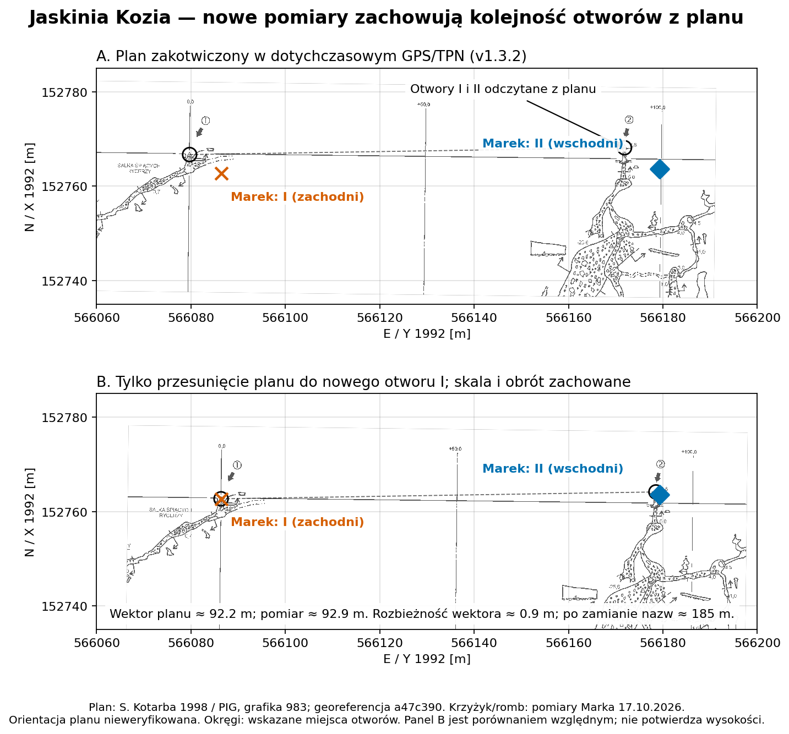
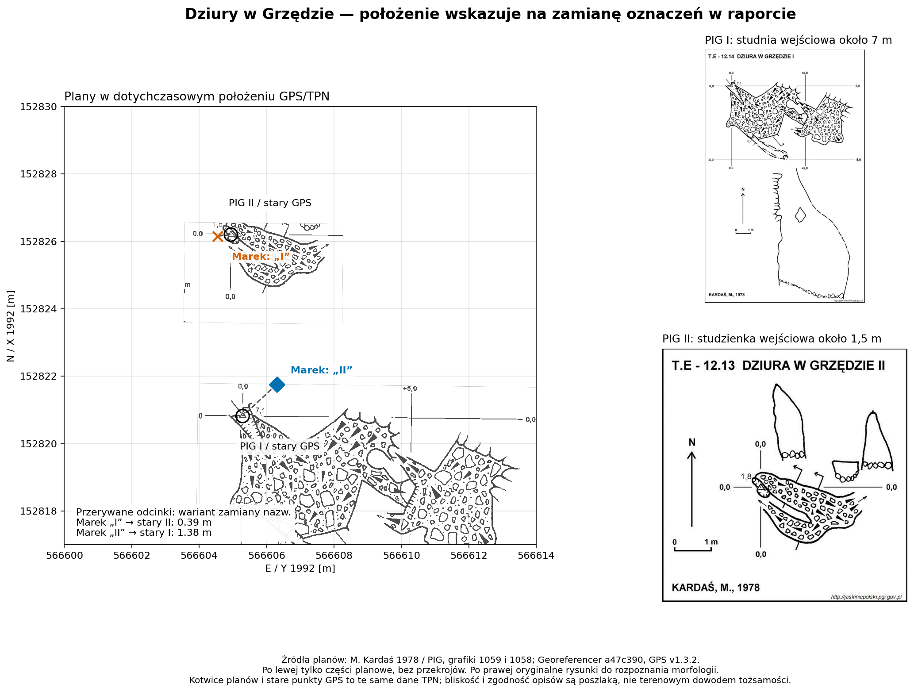

# Issue #41 — otwory Koziej i Dziur w Grzędzie

Analiza na polecenie użytkownika z 2026-11-02. Dane propozycji GPS:
`2c6274db14f2de04ccf4ccbd50a27ebe776116ac`; Georeferencer:
`a47c390955db88d7bdbb4eada4a9315884e9ccbe` (HEAD zgodny z origin/main).
Surowe XLS/PDF Marka pozostają bez zmian.

## Kozia: numeracja zgodna w poziomie, konflikt wysokości pozostaje



I pozostaje zachodni, II wschodni, zgodnie z planem S. Kotarby 1998
w [PIG T.E-11.11](https://jaskiniepolski.pgi.gov.pl/Details/Information/1478).
Po przesunięciu całego planu do nowego punktu I, bez zmiany skali i obrotu,
drugi punkt wypada około 0,91 m od oznaczonego na planie otworu II.
Wektor między otworami ma 92,89 m w pomiarze i około 92,16 m na planie.
Odwrócenie nazw daje rozbieżność wektorów około 185 m.
To przemawia przeciw prostej zamianie nazw I/II w raporcie Marka.

Drugi otwór odczytano ręcznie jako UI `(3994, 952)` na TIFF-ie 8496×8172 px;
robocza tolerancja odczytu ±10 px to około ±0,42 m. I pochodzi z istniejącego
kliknięcia `(1817,16; 1012,22)`. Orientacja planu pozostaje `unverified`;
nie wyprowadzono dokładności pomiaru z bliskości rysunku.

Raport Marka daje **H(II)−H(I)=+2,4766 m**, przekrój PIG **−2,8 m**.
Rozbieżność względna wynosi około **5,28 m**; wspólne przesunięcie datum
wysokości nie usunęłoby tej różnicy. Także [szkic techniczny KKTJ](https://kktj.pl/Portals/0/szkice/t-kozia.pdf)
podaje 0,0/−2,8 m; powtarza historyczny materiał, więc nie jest niezależnym
nowym pomiarem. Do wyjaśnienia pozostaje poziom odniesienia konkretnych
punktów otworowych lub stary pomiar wysokościowy. Nie zmieniono H ani nazw.

## Grzęda: mocne poszlaki zamiany oznaczeń w raporcie



| Punkt z raportu Marka | Odległość do starego I / MTW-0050 | Odległość do starego II / MTW-0016 |
| --- | ---: | ---: |
| „I”, XLS Zestawienie wiersz 10 | 5,39 m | **0,39 m** |
| „II”, XLS Zestawienie wiersz 11 | **1,38 m** | 4,65 m |

Zamiana oznaczeń obniża sumę odległości od 10,03 do 1,77 m. Wtedy I byłby
południowy, II północny, zgodnie z opisami [PIG I / T.E-12.14](https://jaskiniepolski.pgi.gov.pl/Details/Information/1549)
i [PIG II / T.E-12.13](https://jaskiniepolski.pgi.gov.pl/Details/Information/1548).
Obecny raport podaje odwrotną kolejność, o różnicy N około 4,40 m.

Relacja wysokości też wspiera tę hipotezę. W PIG I jest wyżej od II o 1,70 m.
Przy nazwach z raportu Marek daje I niżej o 1,92 m; po zamianie nazw I byłby
wyżej o 1,92 m. Różnica względem relacji PIG spada z około 3,62 do 0,22 m.
Nie jest to kalibracja wysokości ani dowód dokładności starych danych.

**Granica wniosku:** plany Georeferencera są kotwiczone w tych samych
punktach GPS/TPN, z którymi porównano pomiar. Rysunek nie jest drugim
niezależnym potwierdzeniem pozycji. W raporcie XLS oba otwory domierzono
z jednego punktu GNSS (Report wiersze 249–262), ale nie opisano ich morfologii.
Nie znaleziono w sprawdzonych materiałach niezależnych fotografii łączących
nowe punkty z numeracją. Nie zamieniono rekordów w YAML automatycznie.

Najkrótszy sposób rozstrzygnięcia to identyfikacja ze szkicu/notatek/zdjęcia:

> Czy punkt „I” z Report!I251:K251 (N152826,16/E566604,55/H1923,07)
> dotyczy otworu ze studnią około 7 m, czy ze studzienką około 1,5 m?

PIG I ma studnię około 7 m; PIG II — wejściową studzienkę około 1,5 m.
Jeśli północny punkt jest wejściem ze studzienką 1,5 m, propozycja korekty
jest jednoznaczna: **wiersz 10 → MTW-0016 / PIG II, wiersz 11 → MTW-0050 / PIG I**.
Oryginalne nazwy autora powinny pozostać w referencjach i niezmienionym XLS.

## Metoda i odtworzenie

Nie użyto starych `image_georef.tif` ani `computed` jako wzorca bieżącej
geometrii. Uruchomiono `compute_world_file` aktualnego generatora dla
trzech planów, z przypiętym CSV GPS v1.3.2, bieżącymi skalami/kliknięciami
i kątem historycznym T02, według T06. Uwzględniono półpiksela UI/TFW.
Macierz obliczono też niezależnie z kąta, ppm i kotwicy; kontrola zgodna.
Panel B Koziej jest jawnym scenariuszem translacji, nie korektą źródła.

[Liczby, macierze, punkty i SHA-256 wejść](overlay-evidence.json).
Rysunki sprawdzono wizualnie; wartości i przypisania produkcyjne w YAML
pozostają jak w `2c6274db`. Źródła PIG są historycznymi opisami; nie należy
traktować ich jako nowego pomiaru geodezyjnego.

Odtworzenie przy checkoutach wskazanych wyżej i Pythonie z PyYAML,
pyproj, NumPy, Pillow i matplotlib:

```sh
python docs/asdlc/verification/issue-41/overlay.py \
  --georeferencer /sciezka/do/Georeferencer \
  --catalogue . --output build/verification/issue-41-overlay
```
